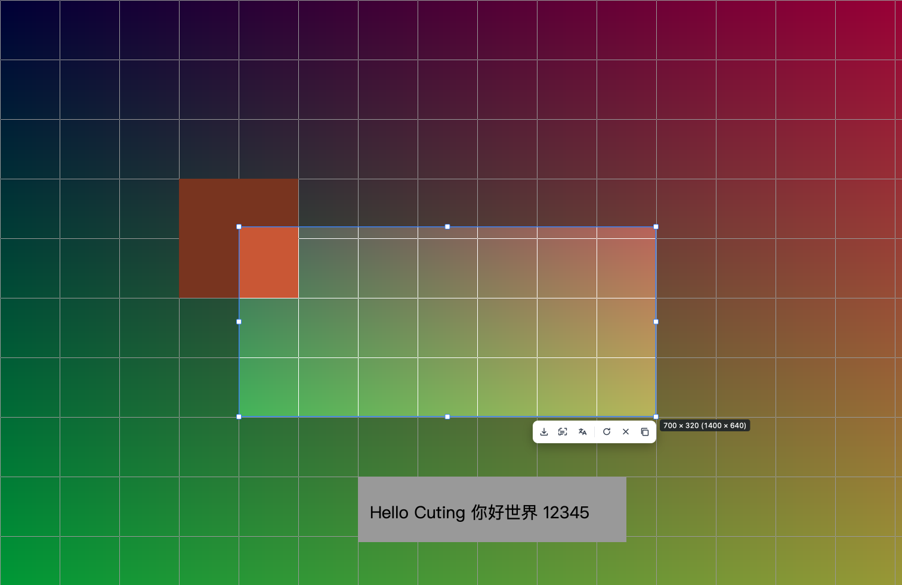

# Cuting

[](https://github.com/LZH0713/cuting/releases/latest)
[](https://github.com/LZH0713/cuting/actions/workflows/release.yml)

轻量的 macOS 截图工具：框选 → 复制/保存，可选提取文字（OCR）和翻译。
Tauri + Rust + React，安装包约 7 MB，OCR 走 Apple Vision（离线、免费）。

<p align="center"></p>

## 功能

- **截图**：全局快捷键框选（默认 `Alt+A`），多显示器、Retina 原生分辨率、sRGB
- **选区**：拖拽框选、单击自动吸附窗口、8 向手柄微调、放大镜（十字线 + `#RRGGBB` 取色）
- **工具条**：选区右下角直接复制（Enter）、保存 PNG、提取文字、翻译；右键逐步退出
- **OCR**：Apple Vision，离线识别中英文混排；结果可编辑后复制
- **翻译**：有道翻译（官方接口，国内直连）/ Google（免配置）/ DeepL / 百度 / OpenAI 兼容接口
- **剪贴板**：图片按屏幕逻辑尺寸写入，贴进备忘录/Pages/Word 不会变大
- **更新**：设置内一键检查/安装，更新包带 minisign 签名校验，更新不丢失系统授权
- 菜单栏常驻（无 Dock 图标），单实例运行

## 安装

从 [Releases](https://github.com/LZH0713/cuting/releases/latest) 下载 `Cuting-macOS-arm64.zip`（Apple Silicon，macOS 14+），解压后拖进「应用程序」。

首次使用需要「屏幕录制」授权：按截图快捷键，按提示到系统设置打开 Cuting，然后允许应用自动重启。之后通过应用内「检查更新」升级不会丢失授权。

未签名构建或绕过 Gatekeeper：`xattr -dr com.apple.quarantine Cuting.app`。

## 隐私

截图数据不上传：OCR 在本机（Apple Vision）；翻译请求只发给你选择的翻译服务；翻译服务的密钥只保存在本机设置文件里；无遥测。

## 开发

```sh
npm install
npm run tauri dev      # 开发模式
npm run tauri build    # 打包 → src-tauri/target/release/bundle/macos/
npm run sign           # 用 Apple Development 证书签名（见下）
```

测试：

```sh
cd src-tauri
cargo test                                   # 单元测试
swift scripts/make-ocr-fixture.swift
cargo test -- --ignored vision_recognizes_fixture   # Vision OCR 端到端
YOUDAO_APP_KEY=… YOUDAO_APP_SECRET=… cargo test --lib -- --ignored youdao_translates_live

# 界面自测：把合成画面放上真实覆盖层，用合成鼠标事件走完整流程（约 10 秒，
# 不需要屏幕录制权限、不抢焦点；结果在 $CUTING_SELFTEST_OUT/summary.json）
CUTING_SELFTEST_OUT=/tmp/cuting-selftest \
CUTING_SELFTEST_FIXTURE="$PWD/target/ocr-fixture.png" \
  src-tauri/target/release/bundle/macos/Cuting.app/Contents/MacOS/cuting

# 设置页自测（隐藏窗口）：录制快捷键、测试代理、保存
CUTING_SELFTEST_OUT=/tmp/cuting-st CUTING_SELFTEST_SCOPE=settings \
CUTING_CONFIG_DIR=/tmp/cuting-st/config \
  src-tauri/target/release/bundle/macos/Cuting.app/Contents/MacOS/cuting
```

### 代码签名

`npm run sign` 用钥匙串里的 **Apple Development** 证书签名。屏幕录制授权绑定在证书上，
因此**只要每次构建都用同一张证书签名，就不需要反复授权**。

`tauri build` 内置的签名在 macOS 15.0 上会被 Finder 给 .app 目录加的
`com.apple.FinderInfo` 属性卡住（"resource fork, Finder information…"），
脚本会清掉该属性后签名；失败时改在干净目录签名再换回。换证书：
`CUTING_SIGN_IDENTITY="证书名" npm run sign`。

### 发布与自动更新

推送 `v*` 标签触发 [.github/workflows/release.yml](.github/workflows/release.yml)：
构建 → （可选）证书签名 → 打包更新工件 → 生成 `latest.json` → 创建 GitHub Release。
应用通过 GitHub Releases 检查更新（`tauri-plugin-updater`），更新包用 minisign 签名验证。

需要的仓库 Secrets：

| Secret | 用途 |
|---|---|
| `TAURI_SIGNING_PRIVATE_KEY` | `~/.tauri/cuting.key` 的内容，签更新包（不配置则只发布安装包，无更新源） |
| `TAURI_SIGNING_PRIVATE_KEY_PASSWORD` | 私钥密码（无密码则留空） |
| `APPLE_CERTIFICATE_P12` + `APPLE_CERTIFICATE_PASSWORD` | 可选，base64 的签名证书。配置后 CI 签名，更新后才保留屏幕录制授权 |
| `APPLE_SIGNING_IDENTITY` | 可选，证书名；不配置则自动取钥匙串里第一张可用证书 |

私钥丢失或更换后，`tauri.conf.json` 里的公钥要同步更新，且老客户端将拒绝新更新包。

## 结构

```
src-tauri/src/
  capture.rs    ScreenCaptureKit 抓屏、显示器/窗口几何、PNG 编解码、放大镜渲染
  overlay.rs    覆盖层窗口生命周期、热键、原生放大镜、AppKit 胶水
  clipboard.rs  按逻辑尺寸写剪贴板
  ocr.rs        Vision 文字识别 + 行合并
  translate.rs  翻译服务（v3 签名等各响应格式的纯函数解析器）
  proxy.rs      代理配置、HTTP 客户端、连接测试、本地代理端口探测
  settings.rs   设置持久化
  commands.rs   IPC 命令（前端 ↔ Rust）
  tray.rs       菜单栏图标与菜单
  selftest.rs   界面自测（环境变量开启）
  geo.rs util.rs
src/
  overlay/   选区覆盖层（React）
  result/    识别/翻译结果窗
  settings/  设置窗
  lib/ipc.ts
```

## 实现笔记（踩过的坑）

- macOS 的 WebKit（同 Safari）**点击按钮不会让按钮获得焦点**，接收按键的监听必须挂在
  `window` 上。设置页自测覆盖的就是这个场景。
- `WebviewWindow::ns_view()` 返回的是 wry 的**容器视图**（即窗口内容视图），不是
  WKWebView 本身；往窗口里插原生视图时要以真正的网页视图为参照。
- `CFRetained::from_raw` 接管引用、不增加引用计数；要"借出"一份必须用 `retain`。
  `capture.rs` 里有引用计数回归测试。
- 屏幕录制权限绑定在**代码签名证书**上：每次重新构建若签名变化就要重新授权，
  用同一张证书签名即可保持授权。
- Google 免费翻译接口（非官方端点）会被 Google 按自己的规则限流（HTTP 429，时好时坏），
  换代理也未必有用；国内建议用有道官方接口。

## License

[MIT](LICENSE)
